# 萌卡节点出租系统

**把节点接入、套餐销售和用户管理，放进一个本地控制台。**

面向萌卡 NT 的节点出租与运营系统。以 Go 并发处理与 WebSocket 长连接为基础，将总节点统一接入，为每份租用提供独立端口、连接凭证和访问范围，配合金币卡密、套餐购买和账号分配，完成从开通到续期的运营流程。

> 本仓库仅用于产品宣传与界面展示，不提供软件包、项目源码或接口文档。项目采用付费交付：软件版 88 元，源码版 188 元，一次购买，永久使用。

## 架构设计

采用单服务部署，将用户中心、运营后台、租用接入和节点转发组织在同一套本地系统中。管理页面随服务一同交付，业务数据保存在自己的电脑或服务器，便于部署、备份与维护。

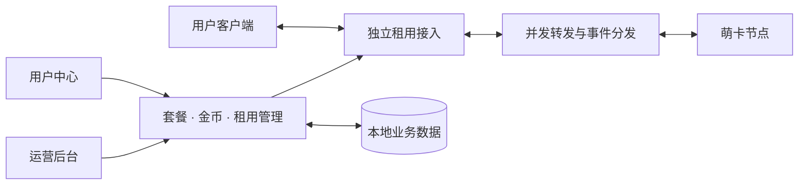

| 设计 | 带来的价值 |
| --- | --- |
| 集中管理，按租用独立接入 | 统一配置总节点，每份租用分别管理端口、连接凭证、到期时间与 IP 白名单 |
| 按节点复用上游长连接 | 同节点的租用共享受控的上游连接，减少重复建连和认证开销 |
| 管理与转发分工 | 用户购买、运营配置和实时连接各有明确处理流程，方便日常运营 |
| 按绑定关系分发数据 | 账号、设备及相关业务数据按租用归属控制，账号共享由管理员明确分配 |
| 程序与数据本地运行 | 无需接入商业授权平台，部署与数据管理由自己掌握 |

独享端口用于区分租用入口；访问范围由服务端结合租用归属和连接规则共同控制。同一 QQ 可由管理员绑定多个子节点，共享账号的业务状态仍来自同一个上游实例。

## 并发处理优势

针对多用户长连接、同时提交任务和持续接收状态变化的场景，系统采用并发处理与连接复用设计。

| 能力 | 设计优势 |
| --- | --- |
| Go 协程并发 | 多份租用可同时处理任务，单份连接也支持多个任务并行等待，减少慢请求带来的排队影响 |
| 长连接复用 | 保持上游连接并复用通信通道，减少反复握手与认证，适合持续交互的客户端 |
| 响应独立匹配 | 并发任务分别关联各自结果，任务可按实际完成顺序返回 |
| 异步事件分发 | 为租用连接设置独立事件队列，按账号绑定关系投递，减少无关数据传输 |
| 负载保护 | 通过并发额度、队列边界和慢连接处理约束资源占用，避免无界堆积 |
| 连接生命周期管理 | 心跳检测、任务超时、断开取消和失效连接清理共同管理长连接资源 |

当前采用单实例部署，实际承载能力取决于服务器配置、上游萌卡处理能力和业务负载；具体容量需结合部署环境压测评估。

## 运营功能

| 模块 | 支持内容 |
| --- | --- |
| 节点管理 | 多节点配置、自定义出租端口池、名额与占用情况查看、节点启停 |
| 套餐销售 | 配置金币价格、有效天数与 QQ 名额，用户自主购买和续期，也可后台直接开通 |
| 金币体系 | 卡密兑换、余额展示、收支流水，充值与购买流程清晰可查 |
| 卡密管理 | 永久有效、明文展示、使用人追踪、查询筛选、复制、TXT 下载与导出、批量删除 |
| 已购节点 | 卡片展示连接状态、账号摘要和有效期，详情弹窗集中管理连接信息 |
| 账号分配 | 用户登录自己的 QQ，或由后台分配已有账号；同一 QQ 支持绑定多个子节点 |
| 设备管理 | 开通时自动生成独立设备指纹，多 QQ 名额支持用户自行生成额外指纹 |
| 连接控制 | 每份租用独立凭证、IP 白名单与有效期校验，同份租用仅保留一个有效连接 |
| 用户与角色 | 本地登录注册、数字字母图片验证码、前后台分区、按角色展示管理菜单 |
| 个人中心 | 当前访问 IP、金币余额、卡密兑换、收支明细与密码修改 |
| 界面体验 | 蓝白卡片、阴影动效、手机适配与抽屉导航，操作结果统一 Toast 提示 |

**运营流程：配置节点 → 上架套餐 → 发放金币卡 → 用户充值购买 → 配置白名单 → 接入使用与续期。**

## 界面预览

以下截图来自本地模拟数据环境，账号、QQ、卡密、余额和节点地址均为测试示例。

| 登录 | 注册 |
| --- | --- |
| 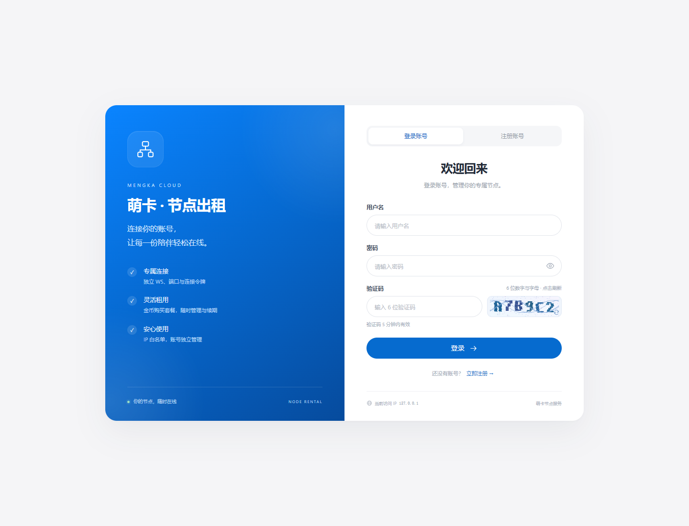 | 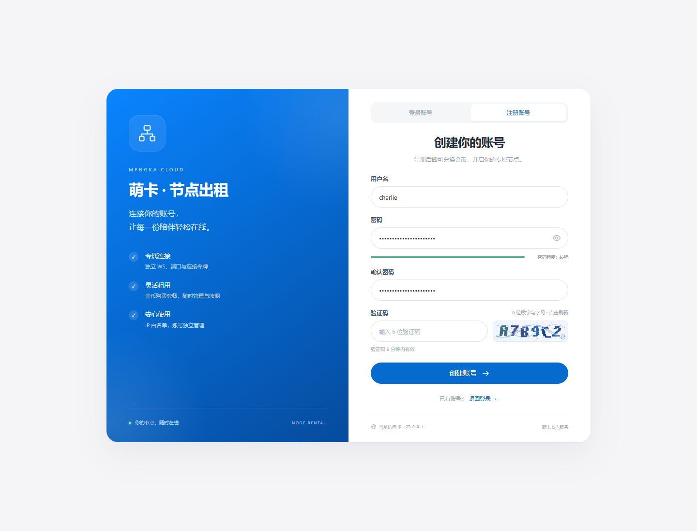 |

| 已购节点 | 个人信息与金币 |
| --- | --- |
| 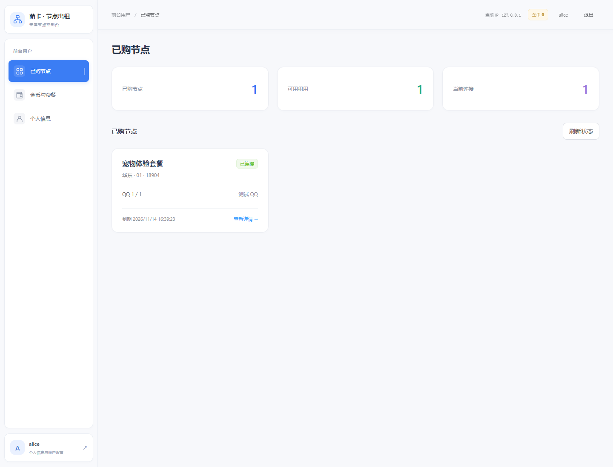 | 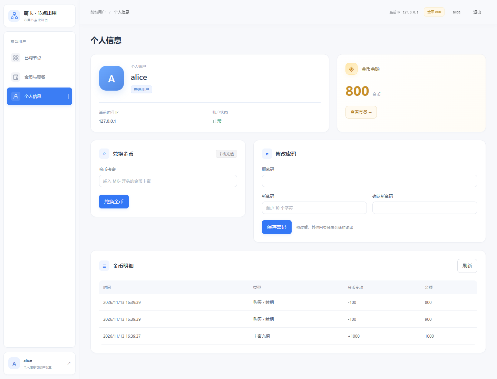 |

| 后台节点与端口 | 卡密查询与使用人 |
| --- | --- |
| 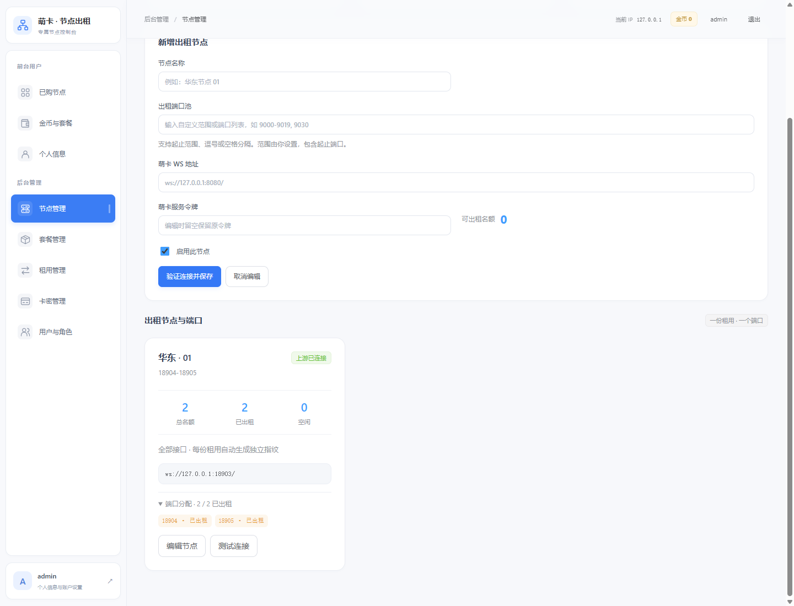 | 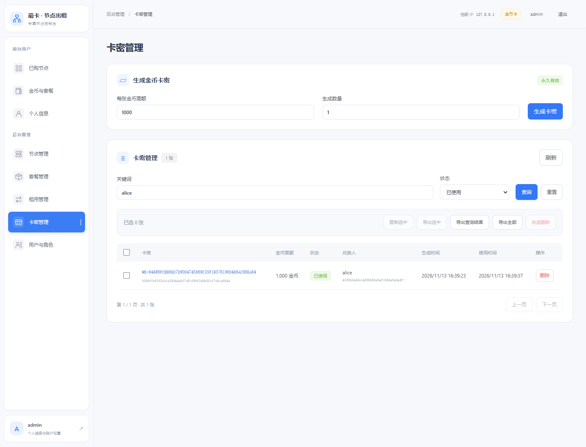 |

查看后台账号分配

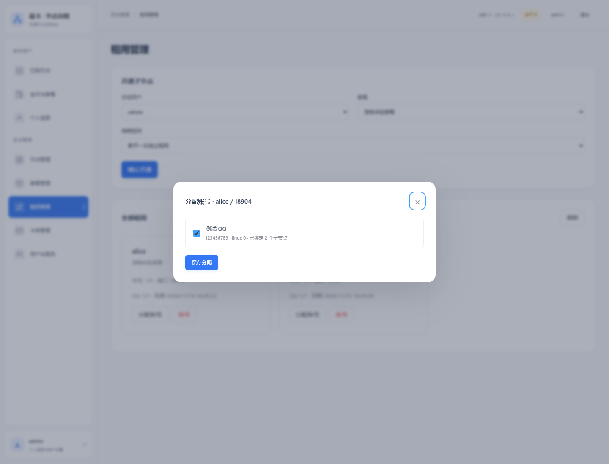

移动端适配：登录、个人信息与抽屉导航。

  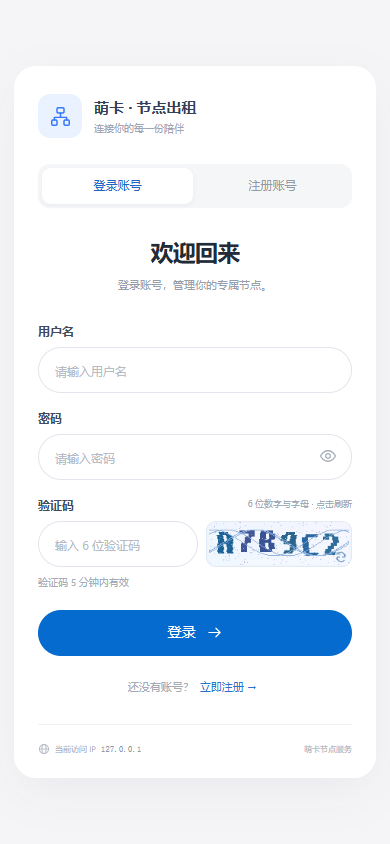
  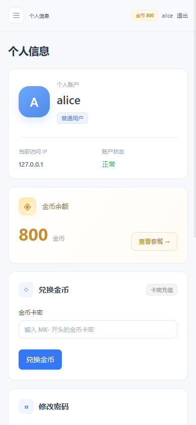
  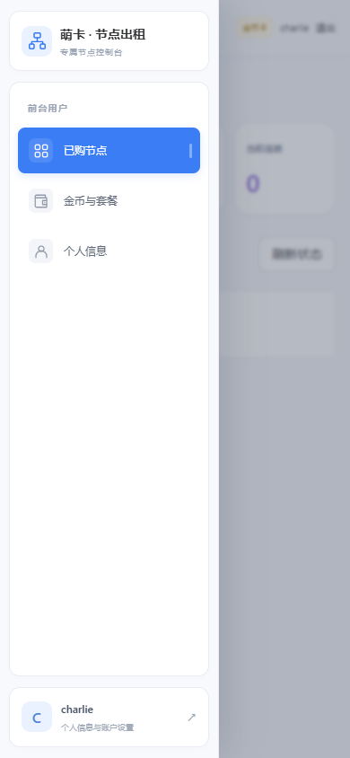

## 购买与交付

**本项目不开源，采用付费交付。一次购买，永久使用。**

| 版本 | 一次性价格 | 交付内容 |
| --- | --- | --- |
| 软件版 | **人民币 88 元** | 可运行的软件，用于本地部署和使用 |
| 源码版 | **人民币 188 元** | 直接交付项目源码，可自行运行和修改 |

软件不设置商业授权校验，无需激活码，不绑定机器，也不依赖在线授权服务器。程序与数据均在自己的电脑或服务器上运行，节点服务由你配置的萌卡提供。

关于不加授权校验的原因：我们认为，目前 AI 辅助逆向能力已经很强，发布软件包后，即便加入授权校验也很难避免被破解。因此直接不加商业授权校验，买到即是永久使用，把精力放在功能和体验上。

软件购买为永久使用，系统内出租套餐的有效期由管理员单独配置。用户登录、角色权限及租用连接控制用于保护业务数据，不属于软件商业授权。

## 一句话介绍

> 用 Go 并发与长连接复用，搭建自己的萌卡节点出租平台。独立接入、金币套餐、账号分配，一套搞定；本地运行，88 元拥有软件，188 元获取源码，买到即永久。
